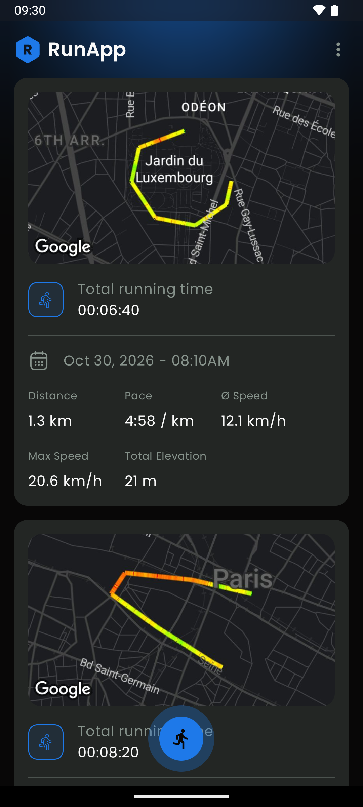
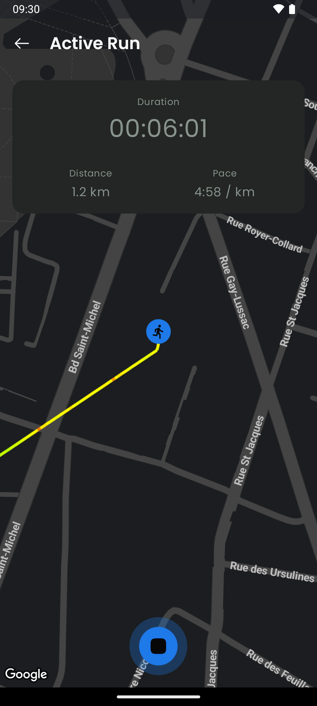
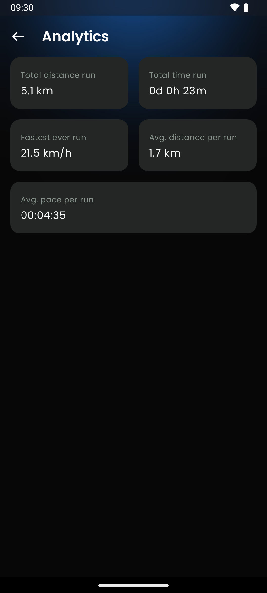
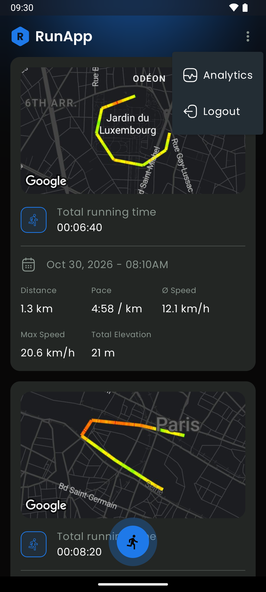
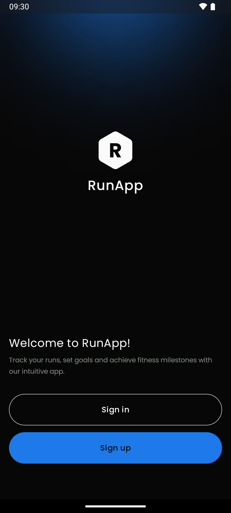
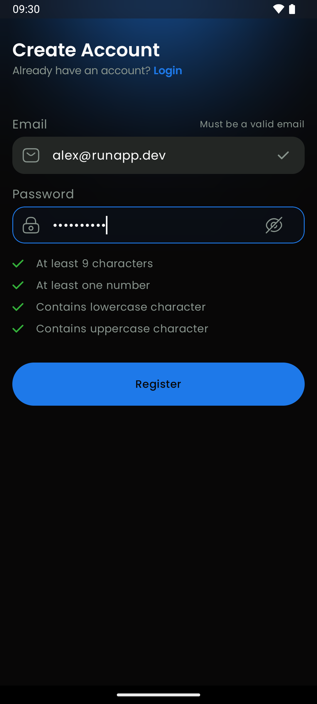
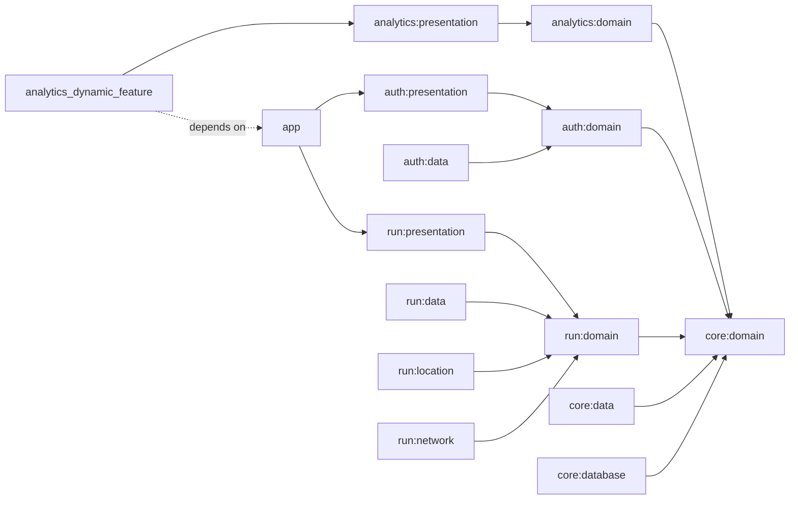
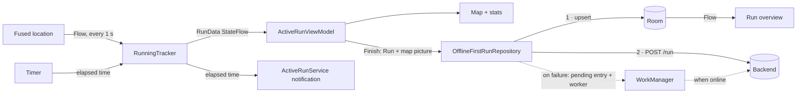

# RunApp

**A running tracker for Android, built with Kotlin and Jetpack Compose.** Start a run, and the app follows you on a
map, drawing your route in colours that go from green to red as you speed up. Duration, distance and pace update live,
even when the screen is off. When you finish, the run is saved with a picture of its map, and synced to your account.

It works **offline first**: every run is written to the device before anything else, and anything that couldn't reach
the server is retried in the background as soon as a connection is back.


-3DDC84?logo=android&logoColor=white)


<p align="center">
  
  
  
  
</p>
<p align="center">
  
  
</p>

## Try it

RunApp isn't on the Play Store. Run it locally on an Android device or emulator: see [Run it locally](#run-it-locally).

You need an account on the backend the app talks to, and a Google Maps API key for the map. Both go in
`local.properties`.

## Features

- **Sign up & sign in** with email and password. The password rules (at least 9 characters, a number, a lowercase and
  an uppercase letter) are checked live as you type, each with its own tick.
- **Stay signed in:** the session is kept in encrypted storage, and the access token is refreshed silently when it
  expires.
- **Live run tracking** on a Google Map with a dark style: your position every second, the route drawn as you go,
  and **duration, distance and pace** updated in real time.
- **Speed-coloured route:** each segment of the line is coloured by your speed, from green (5 km/h) through yellow to
  red (20 km/h).
- **Pause & resume:** pausing stops the timer and starts a new line, so the gap isn't counted as distance.
- **Runs in the background:** a foreground service keeps tracking with the screen off and shows the elapsed time in a
  notification; tapping it brings you back to the run (deep link `runapp://active_run`).
- **Map snapshot:** when you finish, the map zooms to fit the whole route and is saved as a picture with the run.
- **Run history:** every run with its map, date, duration, distance, average and max speed, pace and total elevation.
  Long-press a run to delete it.
- **Offline first:** runs are saved on the device first. Creating or deleting a run without a connection still works;
  the change is sent to the server later, by itself.
- **Analytics dashboard,** delivered as an **on-demand module**: total distance, total time, fastest run, average
  distance and average pace per run. It's only downloaded the first time you open it.
- **Clear permission flow:** location and notification permissions are asked with a rationale explaining why each one
  is needed.

## Tech stack

| Area             | Choice                                                     | Why                                                                                  |
| ---------------- | ---------------------------------------------------------- | ------------------------------------------------------------------------------------ |
| Language         | Kotlin 1.9, Coroutines & Flow                              | One reactive model from the GPS to the screen                                        |
| UI               | Jetpack Compose, Material 3, Navigation Compose            | Modern declarative UI, the standard for new Android apps                             |
| Architecture     | Multi-module, clean architecture, MVI-style ViewModels     | Features isolated from each other; one state, one action entry point per screen     |
| Build            | Gradle convention plugins (`build-logic`), version catalog | Each module's build file is a few lines; versions and config live in one place      |
| DI               | Koin                                                       | Lightweight, no code generation, works with WorkManager and dynamic feature modules |
| Networking       | Ktor client (CIO) + kotlinx.serialization                  | Coroutine-native HTTP client, with a bearer-auth plugin that refreshes tokens       |
| Database         | Room                                                       | Typed SQL with Flows; the single source of truth for runs                           |
| Background sync  | WorkManager                                                | Guaranteed retries with network constraints and exponential backoff                 |
| Location         | Fused Location Provider (Play Services)                    | Accurate, battery-aware positions, including altitude                               |
| Maps             | Google Maps Compose + Maps Utils                           | A Compose-friendly map with polylines and snapshots                                 |
| Security         | `EncryptedSharedPreferences` (security-crypto)             | Tokens stored encrypted with a key from the Android Keystore                        |
| Images           | Coil                                                       | Loads the run map pictures from the server, with caching                            |
| Delivery         | Play Feature Delivery (dynamic feature module)             | The analytics feature isn't part of the base install                                |
| Logging          | Timber                                                     | Debug logs (including HTTP) only in debug builds                                    |

## Architecture

The project is split into **18 Gradle modules**, grouped by feature (`auth`, `run`, `analytics`) plus a `core` shared
by all of them. Each feature has its own `domain`, `data` and `presentation` layers:

```
app/                           Application, MainActivity, navigation, Koin setup
core/
  domain/                      Run, AuthInfo, Result & DataError, repository interfaces (pure Kotlin)
  data/                        Ktor HttpClient, encrypted session, OfflineFirstRunRepository
  database/                    Room database, DAOs, entities
  presentation/designsystem/   Theme, colours, icons, RunApp components
  presentation/ui/             UiText, formatters, ObserveAsEvents
auth/
  domain/                      UserDataValidator, AuthRepository (pure Kotlin)
  data/                        Login, register, email validation
  presentation/                Intro, Register and Login screens
run/
  domain/                      RunningTracker, LocationDataCalculator (pure Kotlin)
  data/                        Sync workers and their scheduler
  location/                    Fused-location implementation of LocationObserver
  network/                     Ktor implementation of RemoteRunDataSource
  presentation/                Run overview, active run, map, foreground service
analytics/
  domain/ · data/ · presentation/
  analytics_dynamic_feature/   On-demand module that hosts the analytics screen
build-logic/convention/        Gradle convention plugins shared by every module
```



**Dependency rule:** `presentation → domain ← data`. Domain modules are **pure Kotlin/JVM** (no Android), so the
running logic (distance, pace, elevation, max speed) knows nothing about GPS, Room or Ktor. The `app` module is the
only one that knows every other module; it wires them together with Koin and owns the navigation graph.

How a run travels through the app:



The run overview only ever reads from Room. Whatever comes from the server is written to the database first, and the
list updates by itself.

## Quality

Automated tests weren't part of this project's goal: the course it follows focuses on architecture, offline-first
sync, background work and feature delivery, so each module only has the template `ExampleUnitTest`. The code is
ready for them, though: the domain modules (`RunningTracker`, `LocationDataCalculator`, `UserDataValidator`) are pure
Kotlin behind interfaces, so they can be tested with fakes (see [Possible evolutions](#possible-evolutions)).

What is in place:

- **Errors as values:** every data call returns a `Result<D, E>` with a typed `DataError` (no internet, timeout,
  unauthorized, conflict, disk full…), mapped to a user-facing message in one place (`DataErrorToText`).
- **Convention plugins** apply the same Kotlin, Compose, SDK and build-type settings to every module, so modules can't
  drift apart.
- **Secrets out of git:** the API key, backend URL and Maps key are read from `local.properties`, which is ignored.

## Decisions & trade-offs

- **Multi-module by feature, then by layer.** Gradle enforces the boundaries (a screen can't reach Room, a domain
  module can't import Android), builds are incremental per module, and a feature could be removed or moved on its own.
  The trade-off is many small modules to configure, which the convention plugins in `build-logic` keep manageable.
- **Room as the single source of truth.** The UI never shows network data directly; it observes the database.
  `OfflineFirstRunRepository` writes locally first, then tries the server, and keeps the server's version on success.
- **Pending-sync tables + WorkManager.** A run that fails to upload is stored in `RunPendingSyncEntity` (with its map
  picture), a delete in `DeletedRunSyncEntity`, and a one-time worker retries when the network is back, with
  exponential backoff. A periodic worker also fetches runs from the server every 30 minutes. Edge case handled: a run
  created and deleted while offline is simply dropped, with nothing sent to the server.
- **The tracker lives outside the screen.** `RunningTracker` is a singleton in the application scope, shared by the
  ViewModel and the foreground service, so leaving the screen or locking the phone doesn't stop the run.
- **Runs as a list of lines.** Locations are stored as `List<List<LocationTimestamp>>`: each pause starts a new line, so
  the map doesn't draw a straight jump and the distance between two lines isn't counted.
- **IDs generated on the device.** Runs get a BSON `ObjectId` when they're created, so a run has the same ID locally
  and on the server, even if it was recorded offline.
- **Analytics as a dynamic feature module.** It shows how to ship a feature on demand with Play Feature Delivery
  (`SplitInstallManager`, `SplitCompat`). The dashboard reads straight from Room with SQL aggregates (`SUM`, `MAX`,
  `AVG`) rather than loading every run in memory.
- **Koin rather than Hilt.** No annotation processing, and modules can be loaded at runtime, which a dynamic feature
  module needs: the analytics module loads its own Koin modules when its activity starts.
- **Encrypted session, silent refresh.** Tokens live in `EncryptedSharedPreferences`; Ktor's `Auth` plugin adds the
  bearer token to each request and calls `/accessToken` when it gets a 401.

## Possible evolutions

Directions the project could take:

- **Tests:** unit tests for `RunningTracker` (with a fake `LocationObserver` and Turbine), `LocationDataCalculator`,
  `UserDataValidator` and the ViewModels; integration tests for `OfflineFirstRunRepository` and the workers; Compose UI
  tests for the auth flow.
- **CI** with GitHub Actions: build, lint and tests on every pull request.
- **Wear OS companion** to start a run from the watch and record heart rate (the strings for it are already there).
- **Release build hardening:** turn on R8 minification and shrink resources.
- **Localisation:** the app is English only; strings are already in resources, ready to be translated.
- **More analytics:** charts over time, weekly and monthly totals, personal records.
- **Run details screen** and editing a run.

## Run it locally

Requirements: Android Studio (Iguana or later), JDK 17, and an Android device or emulator with Google Play services
(for location and maps).

```bash
git clone https://github.com/Vincicent/RunApp.git
cd RunApp
```

Add these keys to `local.properties` at the root (next to `sdk.dir`, which Android Studio creates):

```properties
API_KEY=<the backend API key>
BASE_URL=<the backend base URL>
MAPS_API_KEY=<your Google Maps SDK for Android key>
```

Write the values **without quotes**: the build adds them. `API_KEY` and `BASE_URL` become `BuildConfig` fields; `MAPS_API_KEY` is injected in the manifest by the Secrets Gradle
plugin. Then run the `app` configuration in Android Studio, or:

```bash
./gradlew :app:installDebug
```

| Command                                  | What it does                                                      |
| ---------------------------------------- | ----------------------------------------------------------------- |
| `./gradlew :app:installDebug`            | Builds and installs the debug app on a connected device/emulator  |
| `./gradlew test`                         | Runs the unit tests of every module                               |
| `./gradlew :app:bundleDebug`             | Builds an Android App Bundle, with the analytics feature split out |

**About the analytics module:** `installDebug` only installs the base app, and a debug build can't download the
feature from the Play Store. Run the app from Android Studio, where the dynamic feature is deployed with it (*Run →
Edit Configurations → Dynamic features to deploy*), or test the real on-demand download with
`bundletool build-apks --local-testing`.

**On an emulator,** send a route from *Extended controls → Location → Routes* to simulate a run.

## Credits

- Built while following [Philipp Lackner](https://github.com/philipplackner)'s Android course. The backend is provided
  by PL Coding for the course.

## Author

Built by [**Vincicent**](https://github.com/Vincicent) to learn and demonstrate a production-style Android
architecture: multi-module, offline first, with background work and on-demand feature delivery.
